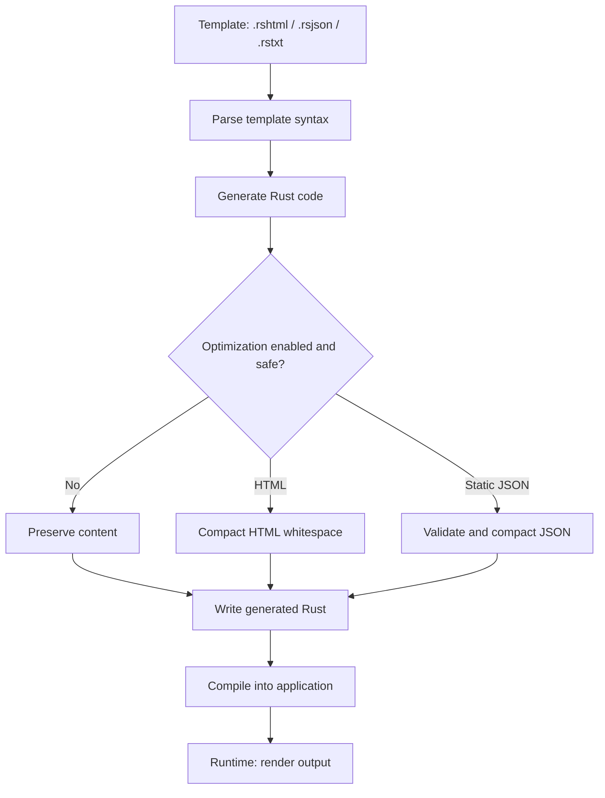

# Template compilation

- All template types share the parser for `@` expressions and directives.
- `CompilerOptions::with_optimization(true)` enables static-write merging and
  whitespace compaction. HTML compaction assumes normal whitespace/default
  display rules and preserves protected or unknown contexts.
- JSON compaction applies only to fully static standalone templates. Dynamic
  JSON and section/layout fragments retain their whitespace. Invalid static JSON
  produces a compile error.
- Plain-text templates are not compacted. Rendering executes the generated Rust;
  it does not parse templates or run the optimizer again.

See [optimization details](./optimization.md) for behavior and limitations.
