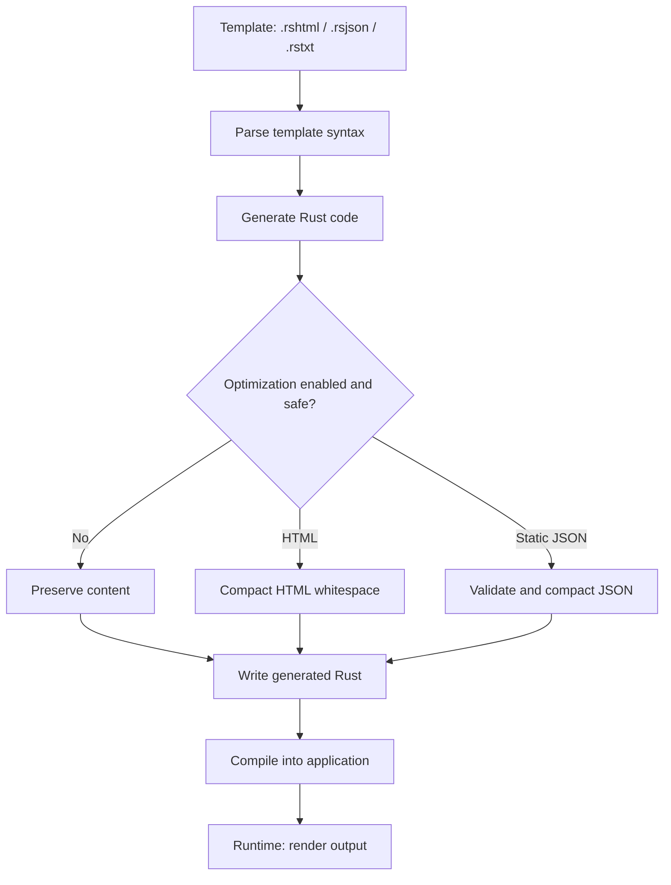

# Template compilation



- All template types share the parser for `@` expressions and directives.
- By default, inline expressions automatically select `WriteTo` when implemented:
  strings and booleans append directly and integer primitives use an `itoa`
  stack buffer. Values are borrowed; HTML expressions stream through an escaping
  writer, while text expressions retain ordinary formatting. JSON expressions
  stream `serde::Serialize` values into the output buffer and propagate serialization
  errors. No compiler option is required.
- In HTML and text templates, other `Display` values automatically fall back to
  `Writer::write_formatted(format_args!("{}", value))` without an intermediate
  `String`. Generated code selects between a conditional inherent method and a
  fallback trait at each concrete expression, without overlapping trait
  implementations or expression-type guessing. The optional
  `sbolt::types::display(value)` adapter forces `Display` formatting.
  `ToString`-only values are not supported; implement `Display` or `WriteTo`,
  or convert explicitly when migrating. Generated dispatch calls `WriteToRef::write_to`
  without dereferencing into the wrapped value, so unrelated methods on the value
  do not participate in lookup.
  The same method takes and returns the output writer for HTML and text templates.
  Generated calls borrow the output writer, wrapped in an `HtmlEscapingWriter` adapter
  for HTML, and discard the returned borrow or adapter. The output buffer stays in
  place, including inside closures. Trusted `raw` values implement `WriteTo` and use
  `Writer::write_raw_formatted` to bypass the escaping adapter, including when borrowed.
  No separate HTML formatting dispatch is needed.
  `Option<T>` forwards specialized writes for `Some` and emits nothing for `None`.
  An optional-value fallback formats `Display`-only contents, including through
  borrowed options, without changing specialized-rendering priority.
  Existing custom writers inherit a streaming formatting adapter over
  `write`; built-in writers format directly into their string buffers.
  A formatting error panics, as it did with `to_string()`.
  The helper deliberately differs from `std::fmt::Write::write_fmt`, so templates
  can import that trait and use standard `write!` calls on local strings.
- Delimited blocks collapse a single child only when it has the same block
  variant as the enclosing block. Otherwise the wrapper is retained, preserving
  the code, content, or section context of that child.
- Generated types and enum variants use CamelCase, so `json_static` produces
  `JsonStaticView`. Generated modules have kind suffixes (`_html`, `_json`,
  `_text`) so same-name templates cannot overwrite one another. Trailing
  underscores avoid sibling directory names, and explicit module paths prevent
  stale generated files from causing ambiguous module lookup. Render lookup paths
  retain their original spelling.
- `CompilerOptions::with_optimization(true)` enables static-write merging and
  whitespace compaction. The default is `cfg!(not(debug_assertions))` in sbolt;
  use `.with_optimization(false)` to disable it explicitly.
  HTML compaction assumes normal whitespace/default
  display rules and preserves protected or unknown contexts.
- JSON compaction applies only to fully static standalone templates. Dynamic
  JSON and section/layout fragments retain their whitespace. Invalid static JSON
  produces a compile error.
- Plain-text templates are not compacted. Rendering executes the generated Rust;
  it does not parse templates or run the optimizer again.

See [optimization details](./optimization.md) for behavior and limitations.

## Repeated rendering and output buffers

The generated module keeps `render(name, kind, context)` and also exposes
`resolve(name, kind) -> RenderResult<KTemplate>`. Resolution returns the existing
generated template enum, not an additional wrapper. It can be copied and reused
with different contexts; it owns neither a context nor a borrowed path.
Its `render(context)` returns `String`, while named rendering continues to return
`(String, Kind)`:

```rust
let template = example_views::resolve("views/welcome", None)?;
let output = template.render(&mut context)?;
```

Only the entry template is cached. Layouts and `@view` calls keep their existing
kind-aware lookup and error behavior; resolution does not validate those
dependencies early.

Generated static-literal byte counts seed each output buffer's capacity. Section
buffers have their own hints; their literals do not inflate the main body or
other sections. Code generation updates an explicitly mutable context; section
contexts keep separate hints while sharing compilation statistics.
This is a heuristic: literals in branches are counted once and
loop trip counts are unknown.
It is not a bound on output length, allocation size, or memory usage. Supply an
estimated total byte count for dynamic content and loops:

```rust
context.set_capacity_hint(140_000);
let output = template.render(&mut context)?;
```

The hint is stored directly on `DefaultViewContext`, not in its data store.
Generated rendering reserves the larger of the static estimate and
`context.capacity_hint()`, not their sum. The setting persists across renders;
`context.set_capacity_hint(0)` restores static-only estimates.
Custom contexts inherit a zero hint from the `Context` trait unless they
override `capacity_hint()`. Existing `render` signatures are unchanged.

Rendering executes directly inside the generated `render` method, which obtains
its writer through `create_writer(kind, capacity_hint)`. The helper retains
kind-aware writer selection and forwards an `Option<usize>` to
`HtmlWriter::new`: `None` starts without reserved capacity and `Some(bytes)`
reserves at least that many bytes. Text and JSON use the same estimate for their
string buffers. Section writers receive only their own compile-time estimates.
Each render returns a fresh `String`; caller-provided output buffers are not
supported. `return Ok(text)` replaces that template's output,
and `return Err(error)` propagates the error. Layouts and sections retain the
intermediate buffers needed for composition.
The context hint applies to layouts and `@view` calls sharing that context.
An independent child context uses its own hint, which defaults to zero.
Section buffers retain their separate compile-time hints.

## Optional typed models

Declare a concrete Rust model type in the template:

```text
@model crate::Teams;
<h1>@(model.title)</h1>
```

`@model` is a top-level declaration, emits no output, and applies to this
template's kind. Duplicate declarations and malformed types are compile errors.
It is not allowed inside code, sections, or nested content blocks. Type names
resolve in the template's module, including its `@use` imports.

Like `@layout`, `@model` is retained as a directive block and read during code
generation, without a separate field on the parsed template. Duplicate and
malformed model declarations are rejected during generation.

Select an explicit context key with an identifier before a colon:

```text
@model layout: crate::LayoutModel;
<title>@(model.title)</title>
@render
```

The full form uses key `"layout"`; the short form defaults to key `"model"`.
The generated variable is always named `model`, regardless of the key.
Omitting the declaration means no typed model and no automatic model lookup.

The model must be `Send + Sync + 'static` because the template remains available
to the named API. Store an `Arc<Model>` under the declared context key to render
by name. Missing or incorrectly typed models return `RuntimeError::InvalidInput`
identifying that key; there is no fallback to another key.
This bridge performs one model lookup and one `Arc` clone per render.

Rendering a concrete generated view skips name resolution, but still retrieves
its model from context. Import the `Template` trait to call `render`:

```rust
use example_views::views::teams_html::TeamsView as TeamsHtmlView;
use sbolt::types::Template as _;

let output = TeamsHtmlView.render(&mut context)?;
```

Import generated view types directly and choose aliases at the call site when
needed. The framework does not generate a separate typed-alias module.
Model lookup remains part of `render`; callers do not pass models separately.

Each layout resolves its own declaration independently from the shared context,
including layouts reached through untyped intermediate layouts. The caller's
model is never forwarded. Pages and layouts can therefore declare
different model types under different keys, for example `"model"` and `"layout"`.
A layout without `@model` needs no model. The same rules apply to both named
rendering and rendering a concrete view type.
Custom views use their own declarations and the context explicitly passed to
`@view`, not the caller's model.

The model is shared immutably during a render. Each render still requires an
exclusive mutable context for sections/layouts. The context store and its
synchronization are unchanged; concurrent renders use separate contexts.

## Kind-aware rendering

The generated registry indexes each logical path by template kind.
`render(path, kind, context)` accepts `Option<Kind>`, defaults `None` to HTML
inside the generated renderer, and returns `RenderResult<(String, Kind)>`; layout
resolution uses the same kind. No negotiation
feature is required to generate or call this API. Missing kinds return a
not-found rendering error without a cross-kind fallback.

`@view(name, context)` generates a nested call to this renderer with the caller's
kind and the supplied context. `@view(name, context, kind)` overrides the child
kind with a Rust `Kind` expression. Both forms pass `Some(selected_kind)` to the
renderer; omitting the override inherits the caller's kind rather than using the
renderer's `None` default of HTML. The child's layout uses the selected kind,
its output is
written directly, and rendering errors propagate. Custom-view output is a dynamic
boundary for static-write optimization. See [custom views](../user/syntax.md#custom-views)
for lookup and context semantics.
Argument boundaries are scanned in a single pass, respecting Rust identifiers,
literal suffixes, and nested comments before expression validation. Line comments
end at LF; a bare carriage return remains part of the comment.

## Dynamic output safety

HTML expressions automatically stream through an escaping writer, preserving
`WriteTo` and `Display` dispatch. `sbolt::utils::raw(value)` explicitly
bypasses escaping for trusted markup. No compiler option is required.
Text expressions, literal markup, rendered sections, and child-view output
are not additionally escaped. JSON expressions automatically serialize complete
values rather than using `WriteTo`/`Display` formatting. Escaping is independent of static-write
optimization; it is not HTML insertion-context analysis. This replaces legacy
raw-by-default HTML interpolation; remove manual escaping and explicitly mark
trusted interpolated markup when migrating.

JSON expressions and the built-in `sbolt::utils::json` helper share a streaming
serializer that escapes characters unsafe for script-data embedding. Generated
JSON expressions serialize directly into the output writer; the helper returns a
string for use outside JSON templates. Serialization errors propagate as
`InvalidInput` rather than returning partial output. `sbolt::utils::raw_json`
validates pre-serialized JSON and returns a borrowed `RawValue` that serializes
without extra quotes. Migration requires removing explicit serialization and
surrounding quotes from JSON-template expressions.

See [output safety](../user/syntax.md#output-safety) for usage and limitations.

## Web integration

Each web example owns a local `ResponseFormat` wrapper around `Option<Kind>` and implements its
framework's request guard/extractor traits for that wrapper. This satisfies the
orphan rules while keeping framework dependencies out of sbolt.
These implementations share the always-exported `sbolt::resolve_kind` and resolve
`Accept` before invoking the handler. Missing headers select HTML. Invalid or
unsupported preferences are stored as `None`; unexpected errors remain HTTP 500.
Quality weights are validated even on unsupported media types.
The examples receive `format: ResponseFormat` and pass `format.into()` to `render`
without parsing again or applying a caller-side fallback. Their responders
infer response content types from the kind returned by the renderer, avoiding
a separate caller-side default for the response metadata. The example responders
add `Vary: Accept` by default, including on rendering errors; welcome handlers
only need `result.into()`. This policy remains outside the renderer.
Their responders set the matching content type and keep rendering failures at
HTTP 500. The engine has no web-framework dependencies, even with all features enabled.
