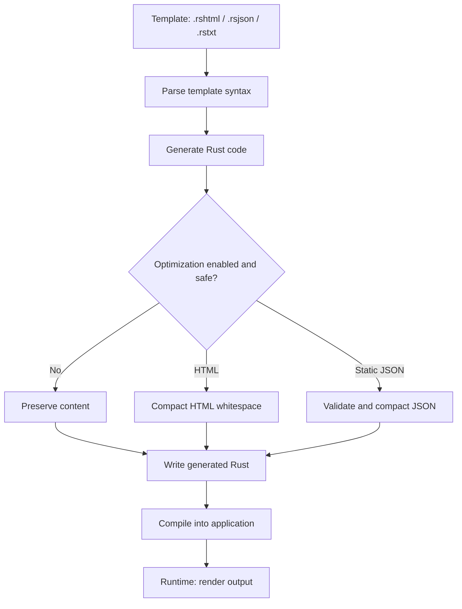

# Template compilation

- All template types share the parser for `@` expressions and directives.
- Generated types and enum variants use CamelCase, so `json_static` produces
  `JsonStaticView`. Generated modules have kind suffixes (`_html`, `_json`,
  `_text`) so same-name templates cannot overwrite one another. Trailing
  underscores avoid sibling directory names, and explicit module paths prevent
  stale generated files from causing ambiguous module lookup. Render lookup paths
  retain their original spelling.
- `CompilerOptions::with_optimization(true)` enables static-write merging and
  whitespace compaction. HTML compaction assumes normal whitespace/default
  display rules and preserves protected or unknown contexts.
- JSON compaction applies only to fully static standalone templates. Dynamic
  JSON and section/layout fragments retain their whitespace. Invalid static JSON
  produces a compile error.
- Plain-text templates are not compacted. Rendering executes the generated Rust;
  it does not parse templates or run the optimizer again.

See [optimization details](./optimization.md) for behavior and limitations.

## Kind-aware rendering

The generated registry indexes each logical path by template kind.
`render(path, kind, context)` accepts `Option<Kind>`, defaults `None` to HTML
inside the generated renderer, and returns `RenderResult<(String, Kind)>`; layout
resolution uses the same kind. No negotiation
feature is required to generate or call this API. Missing kinds return a
not-found rendering error without a cross-kind fallback.

Each web example owns a local `ResponseFormat` wrapper around `Option<Kind>` and implements its
framework's request guard/extractor traits for that wrapper. This satisfies the
orphan rules while keeping framework dependencies out of sbolt.
These implementations share the always-exported `sbolt::resolve_kind` and resolve
`Accept` before invoking the handler. Missing headers select HTML. Invalid or
unsupported preferences are stored as `None`; unexpected errors remain HTTP 500.
Quality weights are validated even on unsupported media types.
The examples receive `format: ResponseFormat` and pass `format.into()` to `render`
without parsing again or applying a caller-side fallback. Their responders
infer response content types from the kind returned by the renderer, avoiding
a separate caller-side default for the response metadata. The example responders
add `Vary: Accept` by default, including on rendering errors; welcome handlers
only need `result.into()`. This policy remains outside the renderer.
Their responders set the matching content type and keep rendering failures at
HTTP 500. The engine has no web-framework dependencies, even with all features enabled.
