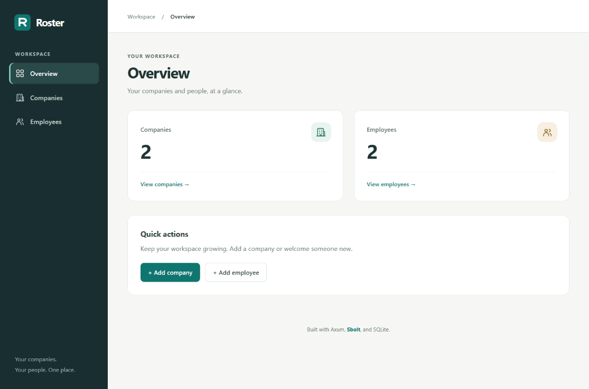

# Roster with Sbolt

A Rust example for managing companies and employees with Axum, Actix Web, or Rocket,
SQLite, and the
[Sbolt template engine](../../../../README.md).

## Features

- Dashboard with company and employee totals.
- Add, edit, and delete companies and employees.
- Assign employees to companies; deleting a company also deletes its employees.
- Responsive navigation, form dialogs, and delete confirmation.
- Input validation, HTML escaping, and form-token checks.
- Persistent SQLite storage with sample data.
- Local CSS and JavaScript, with no external frontend dependencies.

## Getting started

Install stable Rust with edition 2024 support. Windows also requires MSVC C++
build tools.

From the repository root:

```powershell
cd rust\examples\web
cargo run -p "<package-name>"
```

Replace `<package-name>` with the package for your chosen framework:

| Framework | Package name |
| --- | --- |
| Axum | `roster-axum` |
| Actix Web | `roster-actix` |
| Rocket | `roster-rocket` |

The executable has the same name as the package.

All commands run from `rust/examples/web`. Each variant uses the same templates, assets,
migrations, and data-access crate. They default to the same port and database;
run one at a time, or set different `BIND_ADDR` and `DATABASE_URL` values.

Open <http://127.0.0.1:3000>. Stop the server with Ctrl+C.



The first run creates `roster.db` in the working directory with two sample companies
and two employees. Changes persist across restarts; deleted sample data is not
recreated.
Sample data uses fictional Cedar Grove Studio and Harborline Analytics records.
Existing databases created with earlier seed values or column names need a fresh database because
the initial migration has changed. Back up any data you want to keep first.

### Configuration

Set environment variables before starting the app:

| Variable | Default |
| --- | --- |
| `DATABASE_URL` | `sqlite://roster.db` |
| `BIND_ADDR` | `127.0.0.1:3000` (use an IP address and port for Rocket) |
| `ROSTER_ASSETS_DIR` | Source assets during `cargo run`; `assets` beside the executable otherwise |

Use an absolute path when overriding `ROSTER_ASSETS_DIR`. For example:

```powershell
$env:DATABASE_URL = 'sqlite://my-roster.db'
$env:BIND_ADDR = '127.0.0.1:3100'
cargo run -p "<package-name>"
```

## How it works

- Actix Web, Axum, and Rocket each handle their own routes, forms, validation,
  and HTTP responses while reusing the same shared crates.
- [Data](../../../../rust/examples/web/roster/shared/data) manages SQLite connections and queries with SQLx.
- [Views](../../../../rust/examples/web/roster/shared/views) renders build-time-compiled Sbolt templates using
  typed models, a shared layout, and sidebar navigation. HTML values are escaped
  automatically.
- [Configuration](../../../../rust/examples/web/roster/shared/config) reads environment variables and validates
  the asset directory.
- [Assets](../../../../rust/examples/web/roster/shared/assets) contains shared images, CSS, and JavaScript.
  Asset changes do not require rebuilding.

## Project structure

The applications belong to the [web workspace](../../../../rust/examples/web/Cargo.toml),
separate from the [CLI examples](../cli/README.md):

- [actix](../../../../rust/examples/web/roster/actix),
  [axum](../../../../rust/examples/web/roster/axum),
  [rocket](../../../../rust/examples/web/roster/rocket):
  each contains an application in `src/app` and integration tests in `src/app_tests/it`.
- [shared/config](../../../../rust/examples/web/roster/shared/config): startup configuration.
- [shared/data](../../../../rust/examples/web/roster/shared/data): database access, schema, and sample data.
- [shared/views](../../../../rust/examples/web/roster/shared/views): view models and Sbolt templates.
- [shared/assets](../../../../rust/examples/web/roster/shared/assets): images, CSS, and JavaScript.

Build output goes to `target/examples/web` at the repository root.

## Checks

Run from the `rust/examples/web` directory to check all web examples:

```powershell
cargo fmt --all --check
cargo test --workspace
cargo clippy --workspace --all-targets -- -D warnings
```

Tests cover CRUD, employee assignments, validation, HTML escaping, form tokens,
assets, and database persistence.

## Deployment

From `rust/examples/web`, create a release bundle with the
[app-bundle tool](../../../../rust/tools/app-bundle):

```powershell
cargo bundle --package "<package-name>" --profile release
```

Choose `roster-actix`, `roster-axum`, or `roster-rocket`. Use `--profile debug`
for a debug bundle.

The bundle is written to
`target/examples/web/bundle/<package-name>/release` at the repository root.
It contains the executable, shared assets, and a README with run instructions.
Each run deletes and recreates the entire bundle directory.
Back up any files added to an earlier bundle, including a locally created database,
before bundling again; those files are not retained.
Copy that folder to a machine with the same OS and architecture; Rust and Cargo
are not required. Windows may require the Microsoft Visual C++ Redistributable.

- Keep `assets` beside the executable, or set `ROSTER_ASSETS_DIR` to an absolute path.
- Existing databases are not bundled. The app creates `roster.db` in its working
  directory on first run. Use the same writable directory each time, or set
  `DATABASE_URL` to an absolute SQLite URL.
- Back up your database and stop the app before replacing the executable.

Open <http://127.0.0.1:3000>. Stop the server with Ctrl+C.

This is an unauthenticated teaching example. Keep the loopback binding for local
use. Add authentication, authorization, TLS, and per-session CSRF tokens before
deploying publicly.
